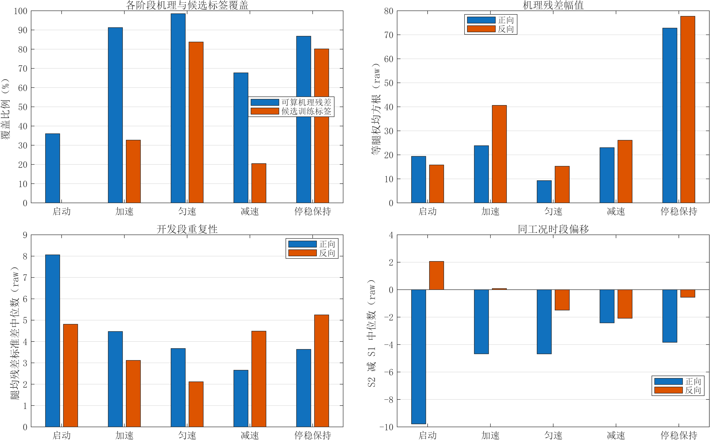

# B1 因果候选数据与机理残差可学习性

**B1 支持启动第一版离线开发。优先检验匀速空间残差和分方向加速残差，短时保持用于检验历史特征。启动、近零速和长保持暂不足以定型。** 本目录只使用 B1 审计通过的 160 个往返。E 全部保留。本次未拟合网络、调整冻结模型或启动设备。

## 数据与使用方法

原始 Watch 为同卡 50 µs 的编码器／反馈电流。每腿从首帧按实际 tick 每 100 帧取当前观测，得到 5 ms 时钟；核对完整帧数、tick 连续性、两方向腿的 Watch／元数据哈希和三份冻结模型哈希。原始 320 腿均保留，包括掩码不合格时刻。电流、残差和误差图统一用 raw。

使用 [候选样本](samples.csv.gz) 时，仅取 candidate=True；模型输入严格由 [features.json](features.json) 的 inputs 指定，输出仅为 residual_raw。文件中的电流、分项、残差、工况、阶段、方向标签、会话及可靠性标志供评价／选样。输入有六列：

| 输入 | 实现 |
|---|---|
| x、v、a | 当前位置，过去 20 ms 含当前点的五个等间隔位置做二次局部拟合，在右端求速度、加速度，单位为脉冲、脉冲/s、脉冲/s² |
| v_history | 速度一阶低通，时间常数 0.1 s |
| still_history | 对 exp[−(v/200)²] 作 0.1 s 低通，连续表示低速停驻程度 |
| arrival_memory | 以绝对行进位移为更新量，按 250 脉冲特征长度趋近 tanh(v/500)，静止时保留最近运动方向的信息 |

腿首历史初始化为速度零、停驻一、方向记忆零。预保持前的转场历史未被同一 Watch 记录，预保持只供诊断。运动及后保持的历史从本腿累积。方向记忆是本次候选特征，需经 C/D 的同位置历史对照检验。所有特征均只读当时及更早的位置，不使用反馈电流。Watch 历史数据是批后读取；在线可用性还依赖部署端提供相同时间基准的编码器流。主机约 16 ms 的轮询无法直接复现本数据的 5 ms 状态精度。

**标签**为实测电流减去位置表、电流惯性项和分方向 F1。位置表按节点线性插值；惯性系数为 3.0306147541×10⁻⁵ raw/(脉冲/s²)。F1 滑动域取 10,000～22,000 脉冲、2,000～40,000 脉冲/s。依据预保持／已停稳事件及因果速度绝对值 ≤50 脉冲/s 识别静止，静止使用零滑动摩擦；位置项仍需有效。全项不可求时保留空标签及仅扣位置和惯性的 M0 诊断量。

**本次保守选样规则**与原始验收独立。用过去 30 ms 七点二次拟合复算；两窗加速度差须 ≤max(30,000, 两窗较大绝对值×20%)，F1 电流差须小于 5 raw，两个窗口都能求机理残差。选近稳态 |a|<30,000 或 |a| 落在 400,000～600,000 脉冲/s² 的样本。该区间只是惯性系数的激励依据，双窗一致也不能保证动态估计无偏。按名义斜坡时长 ≤20 ms 标记低速短斜坡的非匀速运动段；排除未知历史、未定过渡及不满足上述条件的候选标签。所有原格点和多项标志仍可回查，不能将未入选解释为采集失败。

## 阶段覆盖与残差

启动定义为卡侧发令结束后前 20 ms，属于命令对齐的启动窗口。其余运动段以因果加速度乘实际试次方向，相对 ±30,000 脉冲/s² 判定加／减速；近恒速且 |v|≥2,000 时判匀速。停稳前的低速过渡另存。下表统计机理可求格点；RMSE 先求各腿均方再等腿权汇总，偏移是同工况同方向 S2 减 S1 的中位数。方向列均按“正／反”排列。

| 阶段 | 总点／机理可求／严格候选 | RMSE（raw） | S1 腿均残差重复标准差中位数（raw） | S2−S1 偏移（raw） |
|---|---:|---:|---:|---:|
| 启动 | 1,280／461／0 | 19.39／15.79 | 8.06／4.81 | −9.78／+2.06 |
| 加速 | 2,821／2,574／922 | 23.82／40.61 | 4.47／3.12 | −4.68／+0.08 |
| 匀速 | 43,250／42,593／36,219 | 9.28／15.26 | 3.67／2.12 | −4.68／−1.49 |
| 减速 | 4,047／2,740／828 | 23.00／26.08 | 2.66／4.49 | −2.42／−2.08 |
| 停稳后保持 | 64,543／55,999／51,730 | 72.79／77.71 | 3.63／5.25 | −3.84／−0.55 |
| 运动前保持 | 65,978／41,380／0 | 52.05／50.02 | 5.96／6.17 | −1.63／−3.78 |
| 其他过渡 | 19,273／0／0 | — | — | — |

开发集 S01 为 96 对、120,790 格点、53,809 个候选；内部验证 S02 为 64 对、80,402 格点、35,890 个候选。以实际会话整段切分，路径、速度和同工况重复有意跨时段复现，同一往返及相邻点都在同一集合。一次连续作业的两段仅评价时段迁移；未检验未见工况或跨日泛化。后续开发中的调参可按 S01 完整重复轮分组，归一化仅用对应训练部分，避免反复用 S02 选模型；该集已用于本次描述性审计。E 保持封存。

## 可学习性与待补证据

- **匀速。** 对候选点按工况、方向和 500 脉冲位置箱先求腿均，再求时段均值。64 个工况方向组的 S01/S02 空间曲线相关系数中位数 0.777，四分位范围 0.386～0.953，其中 9 组负相关。空间残差有可迁移部分，也有时段偏移。优先做去 x 消融及分方向、分位置误差评价。
- **加速。** 严格样本的平均残差正向 −15.50、反向 +36.41 raw；S1 腿间标准差中位数 4.45／3.02 raw。比匀速更依赖方向和动态状态。先做含／去 a 对照；时延、导数误差和惯性失配仍可贡献同类结构。2、5 mm/s 均无严格加减速候选，10 mm/s 仅有 18 个加速点、无减速点。
- **减速。** 双窗及有效域筛选后，等腿权 RMSE 降至正／反 10.76／9.01 raw。原机理可求样本达 23.00／26.08 raw，反映筛选对结论的影响。适于在有支持的减速段开发，不宜对尾端大误差强行拟合。
- **约 1 s 后保持。** 严格样本的正／反向均值为 +72.03／−76.42 raw。方向相关差异大，但在 B1 每条路径上到位方向与端点绑定。必须用同位置双向到位区分空间效应和历史效应。持续保持后 arrival_memory 的价值及保持电流是否松弛，要靠 D 的时间覆盖检验。
- **启动和过零。** 仅 461 点能计算完整机理残差，且 0 点通过严格候选规则。启动阶段的幅值和偏移只代表可计算子集。当前缺少可靠过零连接；M0 残差可用于诊断，不能当作已扣 F1 的训练标签。
- **C、D。** 当前 C 验收表已有 51 条记录，本次只清点、未引入数据集。先核对直接启动、同向及反向重启在相同探测位置、方向、速度及实际停留时长的配对，重点检查 0.2／0.5／1 s 和低速样本，并连续保留到位—停止—重启的历史；按缺格补足计划。D 重点为同位置双向到位和 3～5 s 保持，比较 0～0.2、0.2～1、1～3 s 及末端窗口，核验方向记忆衰减和参考保持偏差。C/D 共用的停止记录只计一次。

**训练边界。** 严格候选中保持约占 58%，匀速约占 40%，加减速合计不足 2%。未来训练应报告按腿、按阶段的误差，并检验阶段均衡采样的影响；总点误差很容易掩盖动态失败。处理程序已为 E 之前的内部研究准备好数据，正式完整轨迹训练还需要 C/D 的可靠标签、近零速规则及实际部署可获得的状态流验证。跨控制模式结论需要对应模式的独立证据。

复现：安装 NumPy、pandas 的 Python 执行 `python -X utf8 -B prepare.py`，在 MATLAB 中运行 `plot_prep`。输入来源见 [逐腿哈希](sources.csv)，模型哈希见 [特征清单](features.json)。[工况覆盖](coverage.csv)、[逐腿幅值](leg_phase.csv)、[重复性及偏移](repeatability.csv)、[匀速形状](cruise_shape.csv) 和 [划分清单](splits.csv) 均在本目录。
