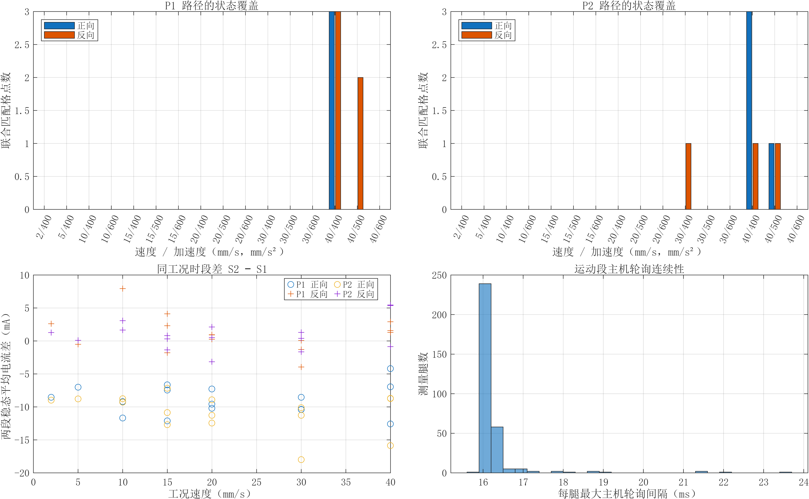

# B1 实测数据质量审计

**结论：冻结点表完整，32 个工况均无需补采。** 160 个往返均有两条实际反向的有效腿，可用于两条短路径的双向动态、稳态和约 1 s 保持分析。低速加速度可辨性、同时达到指定速度和加速度的状态覆盖，以及跨独立现场作业复现，证据仍有限。

审计对象为 [GitHub 默认分支提交 7ea0fa5](https://github.com/Qinyuan-Zeng/ZR_Experiment/commit/7ea0fa5eb13c6d592eef92c949bc27c22e61c4c8)，与本地 HEAD 一致。依据工作区 AGENTS、第三阶段方案及 11 月 27 日取消 B2 的变更、B0 的 gap_matrix、B1 的冻结协议、C++ 入口、Watch 回放程序与批次记录。协议 01 与 02 使用相同点表和保护值；02 修改主机速度保护的计时依据，使用编码器卡时钟。按 slot 和实际 attempt 去重，01 的 72 对和后续 88 对各计一次。

## 数量与协议

P1 为 10,000 ↔ 22,000 脉冲，P2 为 12,000 ↔ 20,000 脉冲。位置伺服、R 固定、无接触，双向 TRAP；每腿包含停稳预保持、完整运动和到位保持。表中加速度是指令档，正反两向采用相同参数。

| 每条路径的速度（mm/s） | 加速度（mm/s²） | 两路径合计工况 | 有效往返 | 有效腿 |
|---|---|---:|---:|---:|
| 2、5 | 400 | 4 | 20 | 40 |
| 10 | 400、600 | 4 | 20 | 40 |
| 15、20、30、40 | 400、500、600 | 24 | 120 | 240 |
| **全部** | | **32** | **160** | **320** |

所有工况均为 5 对，S1 三对、S2 两对。两时段各有 96、64 对。S1、S2 同属一次连续现场作业。69 个请求目录中，48 个有原始批次目录。共 1,376 个原始文件，其中 332 套腿记录各含 Watch、SDK、批读和元数据四件，另有 48 个 guards.csv。190 个已请求的腿次没有启动，占位逐项列出；它们是批次尝试记录，最终点表缺失为零。

| 原始记录类别 | 腿数 | 处理 |
|---|---:|---|
| 冻结协议有效 | 320 | 逐腿重新读取原始文件并执行冻结验收，核对四类输入 SHA-256，按完整对入账 |
| 单腿完整、配对失败 | 2 | R3-P2-V40-A500、R3-P1-V40-A600 的原首腿仅作单腿诊断，各自的正式计数来自完整重采 |
| 失败腿 | 10 | 3 条转场初态不符、2 条连续停稳不足、1 条速度保护触发、4 条位置变化但卡时间戳未更新 |

可恢复的是已有完整测量的批次状态或分析用途。4 份恢复记录使用独立批后复查，另 2 份记录了下次转场前的速度尖峰及复查。失败腿及孤立首腿原样保留。现有正式矩阵没有需要插值补帧、拼接异批两腿或重采的空位。见 [逐尝试清单](attempts.csv)、[逐腿审计](legs.csv)、[逐工况验收](conditions.csv)。

## 原始信号、时序与重复性

| 核查项 | 全部有效腿结果 |
|---|---|
| Watch 连续性 | 20,103,975 帧。逐帧号及模 2³² 卡 tick 检查，周期均为 50 µs，无跳帧、重复、倒序或位置／电流非有限值 |
| 命令与同步 | 每腿发令前后卡时钟包围宽度 0.20～0.50 ms。相对 Watch 起始事件，四个关键事件的卡／主机历时差绝对值最大 0.184 ms。位置和电流同帧；驱动内部电流滤波延迟仍未知 |
| 主机轮询 | 请求 5 ms，运动段各腿实际间隔 P95 的中位数 16.04 ms，最长单次间隔 23.54 ms。高频分析应使用卡时钟 |
| 保持与保护 | 每腿前后完整 1 s 均在端点 ±10 脉冲内。最大主机跟随误差 43.83 脉冲，冻结保护值 500；验收腿无冻结规则所查报警、限位或失能 |
| 速度和加速度 | 320 腿目标位置、速度读回均对应工况。三档加速度实际配置读回约 396.73、494.38、598.14 mm/s²；实测机械加速度的可辨性单独评估。2 mm/s 档的 5 ms 割线速度 P95 均为 2.2 mm/s，单脉冲对应 0.2 mm/s，达到 B1 冻结判据，但超过 B0 历史抵扣筛选的 +5% 上界 |
| 电流与温度 | 有效腿反馈 214～735 raw（256.8～882.0 mA），相邻帧最大变化 10 raw（12.0 mA）。B1 没有冻结软件电流异常阈值，以上是观测范围。卡温 99,330 条保护记录返回码为零但数值全为零，无法进行热漂归因 |

重复性使用完整腿等权。稳态取路径中间 40%、实测速度在目标带内、加速度低于指令幅值 20% 的位置。每工况、每方向五次平均电流的样本标准差，中位数为正向 **7.04 mA**、反向 **2.40 mA**。同工况 S2 减 S1，正向 32/32 格均降低，中位数 **−9.23 mA**；反向中位数 **+0.93 mA**。因此有方向相关的时段偏移；顺序、运动历史和设备状态无法在本次作业中解耦。动态图段另限定实际速度在目标的 25%～75%、加速度幅值为目标的 80%～120%；能提取加速／制动电流的腿为 264／300 条。可计算工况方向组的腿间标准差中位数为 4.96／4.72 mA。指标描述原始电流的重复性。[阶段分组表](repeatability.csv)

## B0 缺口和补采决定

| B0 缺口 | B1 证据及适用范围 |
|---|---|
| 两条短路径的反向动态和完整起停 | B0 可抵扣 0 对；B1 新增正向 160 腿、反向 160 腿，两个端点均有同卡的运动前后保持。完整轨迹缺口已补足 |
| 低速短斜坡 | 2/400 与 5/400 理论斜坡分别为 5、12.5 ms。50 µs 原始记录已保留；5 ms 格点、20 ms 跨度的位置导数窗会平滑短瞬态。2/400 两路径均有阶段有效点为零的腿，5/400 部分阶段最少仅 1 点。低速起停／保持可用，短斜坡的精确加速度暂不作强证据 |
| 指定速度与加速度同时出现 | 采用 B0 的五点中心速度／加速度系数，每 5 ms 取点，在发令后至停稳、路径内、运动方向一致时，要求速度误差 ≤max(0.25 mm/s,5%) 且加速度幅值误差 ≤20%。正／反两向共 7／8 个格点。两向均有格点的仅 P1 40/400、P2 40/400、P2 40/500；P1 40/500、P2 30/400 仅反向。其余 27 格两向均为零。此处统计各向命中数，不能作为相同实际 x、v、a 的一一配对数。TRAP 到目标速度时通常已进入近零加速度段，同样的往返再做几轮也难消除此限制 |
| 跨时段与长保持 | S1/S2 的 3＋2 已齐，可检查同一作业内时段差。跨日／重新上电或独立装夹的泛化、较长保持和不同停留历史仍需相应独立证据 |

**补采清单为空。** 按 B1 冻结用途，32 格均有足量完整实测。进一步利用现存原始 Watch 时，可先对 P1、P2 的 2/400、5/400 做短窗与位置量化敏感性回放，并标记无可靠加速度的样本；无需为了 B0 联合带的空格重复同一点表。若今后要求跨独立现场作业复现，该目标应在独立会话验证，当前 S2 不足以支持这一结论。B2 已取消。

**复现。** 在本目录运行 `python -X utf8 -B audit.py`（NumPy、pandas），再运行 MATLAB 函数 `plot_quality`。冻结采集门槛复用既有只读 check_leg，以保持判据一致；额外的时钟比较、空间中段电流、重复性和状态联合覆盖由本审计从原始信号另算。未训练模型。全部新增文件位于本目录。
