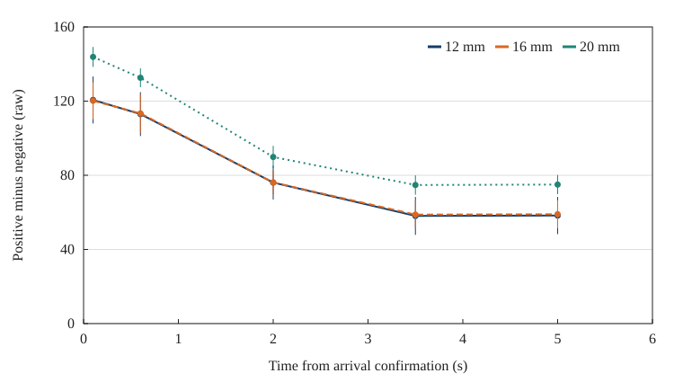
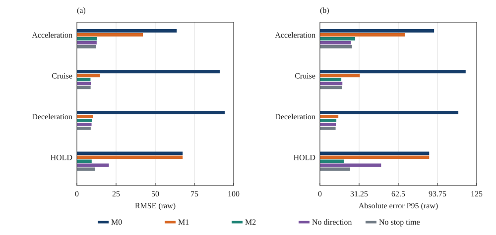

# 第三阶段 B1＋C＋D 因果残差 MLP 第一版

在留出的 **112 个完整统计单位、66,822 个共同有效格点**上，冻结机理模型 M1 的 RMSE 为 **55.23 raw**，加入残差 MLP 后为 **9.03 raw**，下降 83.6%。主要收益来自 HOLD。减速的平均改善较小，且部分 B1 往返、速度和方向出现退化。启动和近零速没有满足严格判据的共同有效格点。结果适用于本批数据的内部评价，E 仍留作独立评价。

## 1. 来源、时间轴和划分

| 来源 | 原始验收数量 | 开发 | 内部留出 | 5 ms 总格点 | 可作训练或评价标签 |
|---|---:|---|---|---:|---:|
| B1 | 160 个往返、320 腿 | S1 第 1～3 轮，96 对 | S2 第 4～5 轮，64 对 | 201,192 | 102,894 |
| C | 126 次 | 第 1～2 轮，84 次 | 第 3 轮，42 次 | 85,692 | 55,522 |
| D | 18 次、90 个有效保持窗 | 第 1～2 轮，12 次 | 第 3 轮，6 次 | 24,351 | 21,617 |
| 合计 | 304 个完整统计单位 | 192 | 112 | **311,235** | **180,033** |

从冻结验收表和批次验收 JSON 交叉核对唯一试次、来源、轮次及归属。核对协议、已验收证据和逐条 Watch、SDK、批读、元数据 SHA-256，B1 原协议继承的 72 对仅计一次。读入原始 Watch 共 31,101,563 帧，逐帧检查 50 µs tick 连续性和帧序号。5 ms 格点取每 100 帧的当时观测，保留原始卡 tick、帧号及相对首帧的时间。电流沿用同一 Watch 帧，无额外平移，驱动电流环／滤波延迟仍未知。C 的接近、停留、探测到停止全程共享同一试次和状态历史。D 的接近波形用于发展历史状态，D 的训练标签仅取到位后的 HOLD。[来源清单](sources.csv) · [划分](splits.csv) · [覆盖](coverage.csv)

B1 S1/S2 来自同一连续现场作业的两段。C 和 D 各自只有一个现场会话。轮次留出检验同工况重复及 B1 的时段变化。跨日、重启、未见轨迹、接触负载和开环力控切换均尚待独立验证。

## 2. 冻结机理与因果输入

- 动态 M0 为冻结位置项 (I_p(x)) 加 (alpha a)，M1 再加冻结 F1。本轮使用 (alpha=3.0306147541	imes 10^{-5}) raw/(pulse/s²)。位置表覆盖 1,000～31,000 pulse，线性插值。F1 滑动支持为 10,000～22,000 pulse 且 (|v|=2,000～40,000) pulse/s。保留备查机理残差和有效域标志，域外滑动 F1 留空。
- HOLD 采用通过离线到位事件、目标 ±10 pulse 与两因果窗 (|v|le 200) pulse/s 检查的静止样本。静止时惯性和滑动摩擦均置零，因而 M0 与 M1 都是 (I_p(x))。事件与目标只用于标签、分析分窗和评价。未知转场前史的预保持保留作备查。
- 主状态用截至当前点的 20 ms 五点二次拟合，30 ms 七点窗作敏感性对照。动态标签要求加速度估计差不超过两窗较大幅值的 20% 或 30,000 pulse/s² 两者中的较大值，两窗 F1 差小于 5 raw。惯性使用近稳态 (|a|<30,000) 或 390,000～610,000 pulse/s²，后者包含实测 TRAP 配置量化（约 396,729、494,385、598,145 pulse/s²）。阈值用于观测筛选，不代表新增惯性标定。名义斜坡 ≤20 ms 的非匀速样本、低于 2,000 pulse/s 的未停稳过渡、无法可靠重建的窗口均无训练标签。
- NN 输入为当前 (x,v,a)、0.1 s 低通速度、0.1 s 低通停驻程度、按 250 pulse 行进距离更新的方向记忆，以及候选 `time_since_stop`。停驻程度低通输入为 (exp[-(v/200)^2])，方向记忆趋向 (	anh(v/500))。停驻时钟以过去 30 ms 位置跨度 ≤6 pulse 且当前 (|v|le200) pulse/s 确认，速度超过 400 pulse/s 或偏离停驻锚点超过 10 pulse 时重置。它和回放中的到位确认时刻有不同的测量口径。B1 每腿独立初始化，C 在一次试次的接近、停留与重启之间连续更新，D 接近段提供保持前史。全程以编码器当前和过去观测重建，不输入反馈电流、未来采样、阶段标签、计划历史标签或会话 ID。
- 当前 Watch 高精度数据由批后回读。现场在线需要等价、及时的编码器状态流，以及对跨帧丢失、历史初始化、进出适用域和平滑衔接的验证。B1 实测主机运动轮询 P95 约 16 ms，现有主机日志不能直接提供此模型的 5 ms 输入。

[特征与冻结模型哈希](data_config.json) · [逐格点数据](joint_samples.csv.gz)

## 3. C：到位历史与重启

比较 C 的探测段及其后 0.5 s 短尾。每个对照在同一重复轮、同一探测方向、同一速度和同一阶段内匹配实测位置／速度／加速度箱（100 pulse、500 pulse/s、30,000 pulse/s²）。HOLD 用位置与停稳年龄 50 ms 箱匹配，静止阶段的机理速度/加速度视为零。先取共同状态箱的平均差，再以三轮完整试次对统计均值和重复性。same/reverse 的同停留对还要求两次实测到位至重启时长相差不超过 25 ms。约 0.2、0.5、1 s 的档位实测分别覆盖 **201.25～217.45、501.45～514.40、1001.40～1017.05 ms**。

- **到位方向**：18 个速度×探测方向×停留档组合在匀速都有 3 对成功匹配。reverse 减 same 的条件均值在负向探测为 **+13.55～+20.53 raw**，在正向为 **−8.36～−5.71 raw**。探测后短尾也有 18 个条件各 3 对，负向差为 **+4.44～+9.96 raw**，正向范围 **−7.73～+8.02 raw**，方向效应在正向尾段较不一致。
- **停留时长**：在 same 或 reverse 各自内部跨档比较时，匀速和探测后 HOLD 的条件均值差绝对值中位数分别为 **0.87、1.12 raw**（各 36 个条件，均覆盖 3 对），低于同档改变到位方向的 **10.96、6.62 raw**。可靠加速窗口的停留跨档比较只有 5 个条件，均少于 3 对，暂难判断可重复性。
- **直接启动**：direct 有 2 mm/s、20 mm/s² 慢速接近和约 2 s 等待，same/reverse 的接近为 10 mm/s、400 mm/s²。状态配对后的 direct 对照可描述差异，接近条件与停留同时变化，不能单独归因给其中一项。
- **启动和近零速**：发令结束后前 20 ms 的严格启动格点为 0，未停稳近零速也为 0。逐试次启动及近零速原始电流减位置项量级单列作为诊断。C 探测减速无通过严格判据的格点，当前能评价的是探测后的短时 HOLD，以及有覆盖的探测匀速与部分加速。

[逐试次阶段](C_trial_phases.csv) · [实测状态配对](C_matched_trial_pairs.csv) · [条件汇总](C_matched_summary.csv) · [启动与近零速诊断](C_start_nearzero_diagnostic.csv)

## 4. D：长保持及方向差

用已验收原始 50 µs 结果的五个窗口，按同位置、同一重复轮配对正反向。下表是正向减反向平均残差，括号为三对样本标准差，单位 raw。

| 位置 | 0～0.2 s | 0.2～1 s | 1～3 s | 3～4 s | 4～6 s |
|---|---:|---:|---:|---:|---:|
| 12 mm | 120.63 (12.66) | 112.99 (11.84) | 76.06 (9.13) | 58.09 (10.23) | 58.28 (10.03) |
| 16 mm | 120.18 (9.92) | 113.37 (10.49) | 76.13 (6.47) | 58.79 (7.53) | 59.00 (7.55) |
| 20 mm | 143.85 (5.36) | 132.59 (5.10) | 89.87 (6.01) | 74.76 (5.24) | 74.99 (5.19) |

方向差到 3～4 s 已接近 4～6 s 的水平，仍保留 **58～75 raw**。20 mm 的末段方向差比 12 和 16 mm 高约 16 raw。末段双向中心偏差在 12、16、20 mm 约为 −8.84、+3.78、+8.07 raw，正反向残差没有完全对称。末窗每个位置只有 3 对，位置效应尚需独立会话复现。



[逐轮方向配对](D_hold_trial_pairs.csv) · [方向差与双向中心](D_hold_summary.csv)

## 5. 模型、共同支持评价与退化

M2 为 M1 加一个 7→24→16→1 的 tanh MLP。以 raw 残差为目标，Huber 转折 25 raw，Adam 0.002，100 epoch、每轮 24 个批次，批量 256。按来源×阶段均衡，再按完整单位等权和单位内格点均匀采样。输入和标签标准化仅用开发集的同口径加权统计。训练设置预先固定，主表用预设种子 426，427/428 检查初始化敏感性。内部留出不做标准化拟合、早停或挑种子。四个模型分别保存权重与归一化参数。

下表每格依次为 **RMSE / MAE / 绝对误差 P95 / 平均偏差**（raw，偏差为实测减预测）。M0、M1、M2 使用逐行相同的有效格点。先对完整单位等权，再汇总；B1 一个单位含双向两腿，C/D 一个单位为整试次。P95 从按单位等权的误差经验分布求得。样本计数不等于独立试次数。

| 阶段 | 单位／格点 | M0 | M1 | M2 |
|---|---:|---:|---:|---:|
| 全部 | 112 / 66,822 | 75.15 / 72.56 / 102.80 / −3.54 | 55.23 / 46.58 / 85.21 / −0.92 | **9.03 / 6.93 / 17.85 / −2.72** |
| 启动 | 0 / 0 | — | — | — |
| 加速 | 86 / 470 | 63.71 / 60.49 / 91.05 / +1.80 | 42.12 / 37.20 / 67.66 / +8.03 | **12.90 / 9.89 / 28.09 / −2.72** |
| 匀速 | 106 / 22,093 | 91.13 / 89.76 / 116.22 / −5.60 | 14.80 / 11.32 / 31.83 / +1.69 | **8.69 / 6.80 / 17.05 / −2.04** |
| 减速 | 44 / 431 | 94.30 / 93.84 / 110.39 / −0.14 | 10.31 / 5.89 / 14.70 / +1.61 | **9.59 / 5.53 / 13.10 / −2.90** |
| 近零速 | 0 / 0 | — | — | — |
| HOLD | 112 / 43,828 | 67.48 / 65.32 / 87.14 / −2.93 | 67.48 / 65.32 / 87.14 / −2.93 | **9.43 / 7.12 / 19.05 / −3.34** |



**局部退化。** 减速共同支持全部来自 B1，44 个往返中有 20 个 RMSE 上升，最大增加 **4.24 raw**。B1 正向 30／40 mm/s 匀速分组的 RMSE 分别从 **7.65→10.75**、**8.21→10.26 raw**。C 的总体改进由 HOLD、匀速和少量加速共同贡献。启动与近零速只有不具备三模型共同支持的诊断数据，不能从其他阶段外推。

| 版本 | 内部整体 RMSE | HOLD RMSE | D HOLD RMSE |
|---|---:|---:|---:|
| M1 | 55.23 | 67.48 | 40.29 |
| M2 全特征 | **9.03** | **9.43** | **6.98** |
| 去方向记忆 | 17.91 | 20.41 | 43.56 |
| 去停驻时间 | 10.50 | 11.59 | 10.99 |
| 两项都去除 | 19.37 | 21.78 | 51.62 |

- **方向记忆**的收益集中在 HOLD，尤其 C、D。D 去掉后甚至高于 M1。动态段中去掉方向记忆的影响较小且方向不一，不能据此宣称所有运动阶段都会受益。
- **停驻时间**主要改善长保持。D 留出的 6 次中，4～6 s 窗 RMSE 由去时间版 **9.83** 降为全模型 **4.55 raw**，前 0～0.2 s 则为 **9.44→9.33 raw**。全模型三种子整体 RMSE 为 **8.77～9.04 raw**。总体消融排序在三种初始化中保持一致。
- 当前 M2 是内部研究候选。启动、近零域和部分制动／高速稳态工况的不确定性需在后续独立轨迹中单独考察，模型适用域和最终模型仍待 E 判定。

[评价表](evaluation.csv) · [按整试次的误差](evaluation_by_trial.csv) · [按速度与方向分层](evaluation_subgroups.csv) · [逐试次退化检查](paired_regression_check.csv) · [D 停驻时间消融](D_hold_ablation_by_age.csv) · [三种子敏感性](seed_sensitivity.csv) · [启动与近零速 M0 诊断](unsupported_diagnostics.csv)

## 6. 复现与文件

从工作区根目录，在同一 Python 环境下顺序执行。依赖 NumPy、pandas，图以可编辑 SVG 生成。

```powershell
$py = 'C:/Users/HYB/.cache/codex-runtimes/codex-primary-runtime/dependencies/python/python.exe'
$p = './分项实验/03_摩擦与残差补偿/联合建模_v1'
foreach ($script in 'prepare_joint.py','train_joint.py','analyze_joint.py') {
  & $py -X utf8 -B (Join-Path $p $script)
  if ($LASTEXITCODE -ne 0) { break }
}
```

模型文件以 `np.load(..., allow_pickle=False)` 读取。按文件内 `features` 顺序取值、用 `x_mean/x_scale` 归一化，分别经过 `tanh(X@W1+b1)`、`tanh(H1@W2+b2)`、`H2@W3+b3`，用 `y_scale/y_mean` 还原 raw 残差，再加到有效 M1 上。训练脚本逐模型核验序列化前后的内部预测一致。

[训练配置](training_config.json) · [训练损失](training_loss.csv) · [完整 M2 模型](models/M2.npz) · [内部逐格点预测](internal_predictions.csv.gz)

本轮仅使用已采集的 B1、C、D 与冻结机理模型。原始数据、协议、B1-only 成果均保留。未启动设备、使用 E 数据或冻结最终模型。
